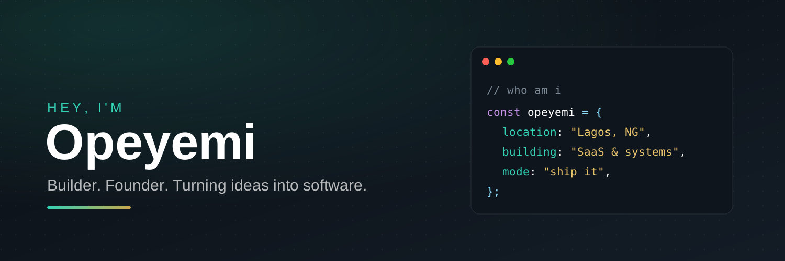

  

<!--
  Developer showcase — Opeyemi Akinremi
  Keep project links and technology claims aligned with work that is publicly shareable.
-->

# Opeyemi Akinremi

### Full-Stack Software Engineer | Founder, The Giant Reach

**I build software products and business systems that solve practical problems.**

---

## About

I'm a Nigeria-based software engineer and entrepreneur focused on building useful digital products, SaaS applications, and workflow systems.

I approach engineering from both a technical and business perspective: understand the problem, map the workflow, then build a solution that is clear, reliable, and maintainable.

At **[The Giant Reach](https://www.thegiantreach.com)**, I work on client acquisition and workflow systems for immigration firms in Africa, alongside focused software products.

## Featured Work

### [VisaByte](https://visabyte.thegiantreach.com)
A self-serve SaaS platform for study-abroad and visa consultancy firms. It helps teams manage student enquiries, applications, documents, tasks, and communication in one workspace.

### [The Giant Reach](https://www.thegiantreach.com)
My software studio, building client acquisition and workflow systems for immigration firms in Africa.

### [More projects](https://www.thegiantreach.com/portfolio)
Explore selected product and application work, including project context and previews.

## Technology & Tools

  
  
  
  
  
  
  
  
  

I choose tools based on the requirements of the product, with an emphasis on maintainability, performance, and a good developer and user experience.

## Engineering Principles

- Solve the actual problem before choosing the technology.
- Design workflows around the people who use them.
- Keep interfaces focused and accessible.
- Build secure, maintainable foundations.
- Prefer useful functionality over unnecessary complexity.

## GitHub Activity

### Currently building

- **[VisaByte](https://visabyte.thegiantreach.com)** — SaaS for study-abroad and visa consultancy firms.
- **[Convertly](https://github.com/thegiantreachmedia-max/convertly-showcase)** — WhatsApp-based B2B sales automation.
- **[TGR GA4 API](https://github.com/thegiantreachmedia-max/tgr-ga4-api)** — Server-side Google Analytics 4 reporting API.

## Let's Connect

I'm interested in meaningful conversations about software engineering, SaaS, product development, and technology for business operations.

  
  
  
  
  
  

---

  Building useful software. Solving real problems. Improving systems one problem at a time.

